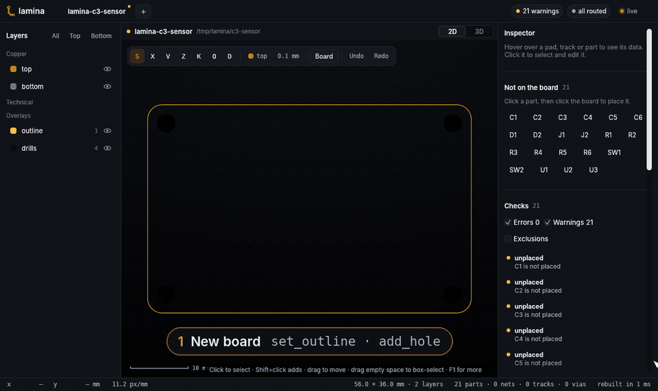
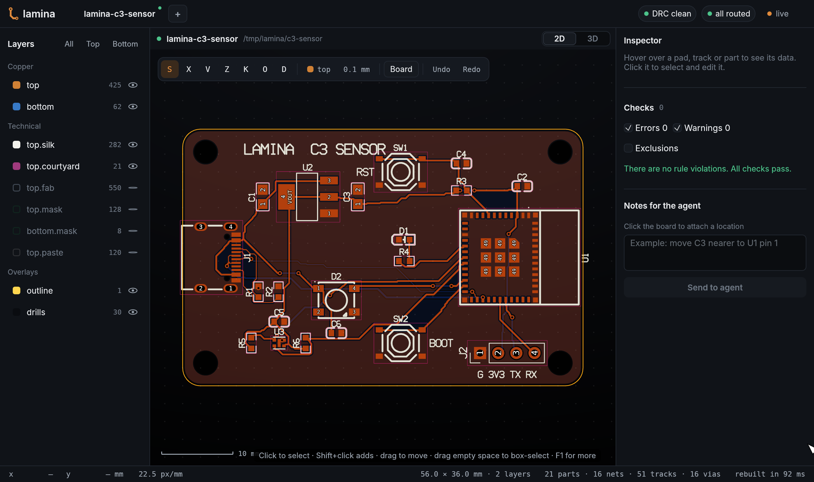
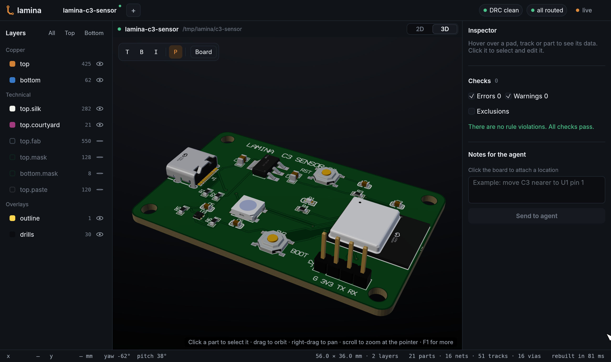
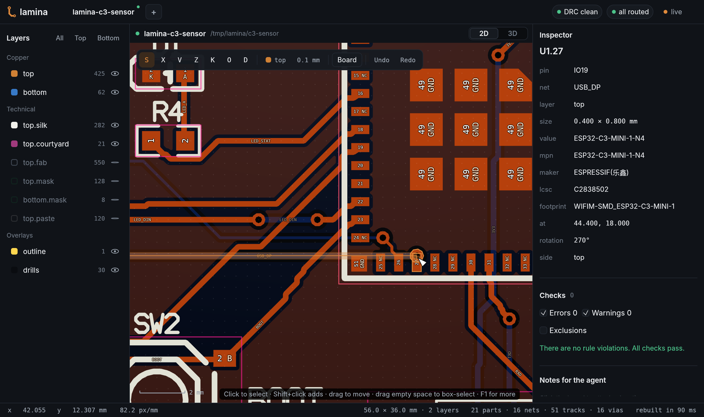
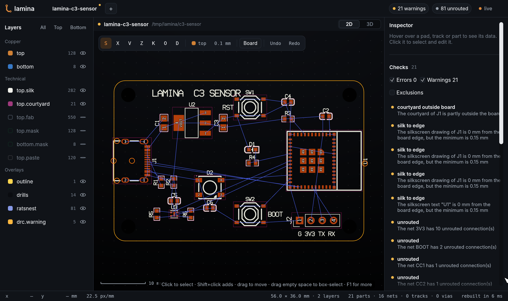
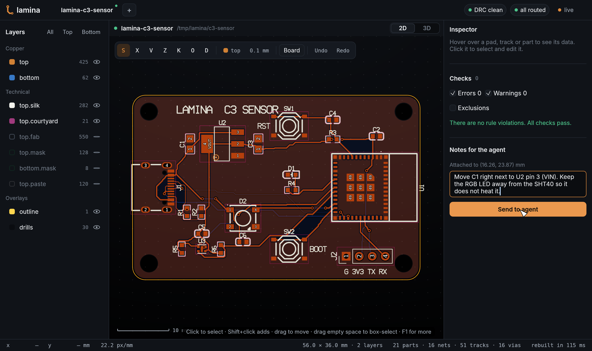
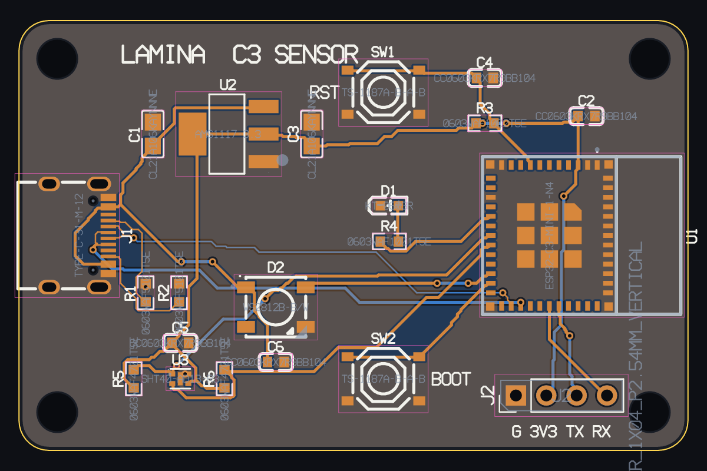

<p align="center"></p>

<h1 align="center">Lamina</h1>

<p align="center">
  <b>PCB layout for AI coding agents.</b><br>
  Your agent places the parts, routes the board and runs the checks.<br>
  You watch every change live, in 2D and 3D, and take the mouse when you want.
</p>

<p align="center">
  <a href="https://github.com/meraworks/lamina/releases/latest"></a>
  <a href="https://github.com/meraworks/lamina/actions/workflows/ci.yml"></a>
  
  
  <a href="#licence"></a>
</p>

<p align="center">
  <a href="#quick-start">Quick start</a> ·
  <a href="#a-tour-of-the-viewer">Tour</a> ·
  <a href="#what-the-agent-can-do">Tools</a> ·
  <a href="docs/guide.md">User guide</a> ·
  <a href="docs/architecture.md">Architecture</a>
</p>

<p align="center">
  
</p>

<p align="center"><sub>
  A real session: the agent calls the Lamina tools (shown in each caption) and <code>lamina-viewer</code>
  shows each change. The board is an ESP32-C3 sensor board with USB-C, 21 real LCSC parts and 2 layers.
  <a href="examples/c3-sensor">Build it yourself</a>.
</sub></p>

## Why Lamina

PCB programs were made for a mouse and a keyboard. Lamina was made for an agent.

- **The agent does the work.** `lamina` is an MCP server with 73 tools: search real
  parts, import them with footprints and 3D models, place, route, pour, check and export
  the fab files.
- **You stay in control.** `lamina-viewer` shows the board in 2D and 3D and updates
  each time a file changes. Edit the board in the viewer at any time, or leave a note
  for the agent on the board.
- **Files you can read.** A board is a folder of small JSON files. Diff them, review
  them, commit them. You can also write a board in Jsonnet and reuse circuit blocks.
- **Works with your tools.** Lamina reads and writes KiCad boards, reads EasyEDA and
  Gerber files, and writes Gerber X2, Excellon, BOM, CPL, IPC-D-356 and STEP.

> [!NOTE]
> Lamina is young and changes fast. Check the boards it makes before you order them,
> as you would with any tool. Issues and ideas are welcome.

## Quick start

**1. Get Lamina.** Download the archive for your computer from the
[latest release](https://github.com/meraworks/lamina/releases/latest). It has two
programs: `lamina` and `lamina-viewer`. Or build them from source with
[Rust](https://rustup.rs) 1.90 or later:

```sh
git clone https://github.com/meraworks/lamina && cd lamina
cargo build --release      # the programs are in target/release
```

**2. Connect your agent.** Claude Code:

```sh
claude mcp add --scope user lamina -- /path/to/lamina mcp
```

<details>
<summary>Codex and other MCP clients</summary>

Codex, in `~/.codex/config.toml`:

```toml
[mcp_servers.lamina]
command = "/path/to/lamina"
args = ["mcp"]
```

Any MCP client that can start a program on stdio works the same way: the command is
`lamina mcp`.

</details>

**3. Open the viewer** on the folder where the board will go. It shows the board as
soon as the agent makes it:

```sh
lamina-viewer my-board
```

**4. Ask for a board.** For example:

> Make a 50 × 30 mm board in `my-board` for the JLCPCB 2-layer rules: a USB-C
> connector, an AMS1117-3.3 regulator and an ESP32-C3-MINI-1 with a reset button,
> a boot button and a status LED. Use LCSC parts. Route it, pour ground on both
> layers, make DRC clean, then export the fab files.

The agent searches the parts, checks each pin name against its net, places, routes,
checks and exports. Talk to it as you work: "move the LED to the edge", "make the
power tracks wider", "show me the bottom in 3D".

**No agent at hand?** The example script calls the same tools that an agent calls.
It builds the board of the GIF in about ten seconds:

```sh
python3 examples/c3-sensor/build.py && lamina-viewer c3-sensor
```

## A tour of the viewer

<table>
<tr>
<td width="50%"></td>
<td width="50%"></td>
</tr>
<tr>
<td><b>2D layout.</b> Layers, tracks, pours and silkscreen. The top bar shows the DRC
and routing state at a glance.</td>
<td><b>3D view.</b> Each part has the 3D model of its vendor. Drag to orbit, scroll
to zoom. Push <code>1</code> and <code>2</code> to change views.</td>
</tr>
<tr>
<td></td>
<td></td>
</tr>
<tr>
<td><b>Pin names from the datasheet.</b> Zoom in to see pad numbers, pin names and
net names. Hover a pad for its data. Here pin <code>IO19</code> is on <code>USB_DP</code>.</td>
<td><b>Checks as you work.</b> DRC and connectivity run after each change. Click a
violation to go to it. The ratsnest shows the open connections.</td>
</tr>
<tr>
<td></td>
<td></td>
</tr>
<tr>
<td><b>Notes for the agent.</b> Click the board and write what you want. The agent
reads the note, with its location, through the <code>notes</code> tool.</td>
<td><b>The agent sees too.</b> The <code>render</code> tool gives the agent images of
the board, in layers, as the finished board or in 3D.</td>
</tr>
</table>

You can edit the board in the viewer while the agent works. Each side reads the files
again before it writes, so neither one writes over a change of the other.
[More about the viewer](docs/guide.md#viewer).

## What the agent can do

| | Tools |
|---|---|
| **Parts** | `search_parts`, `import_part(s)` from LCSC / JLCPCB (stock, price, footprint, 3D model) and KiCad libraries, `footprint_from_package`, `footprint_from_pads`, `set_model` |
| **Board** | `set_outline`, `set_stackup`, `use_fab_preset`, `add_hole`, `add_text`, `add_keepout`, `add_zone` |
| **Netlist** | `set_nets`, `connect`, `pins` (each pad with its pin name and net), `set_diff_pairs` |
| **Placement** | `place_many`, `move_parts`, `rotate_part`, `flip_part`, `align`, `distribute`, `repeat_layout` |
| **Routing** | `autoroute`, `route_trace`, `add_via`, `route_diff_pair`, `tune_length`, `add_teardrops`, `ripup` |
| **Checks** | `check` (DRC, connectivity, pin roles, silkscreen, thermals), `set_rules`, `exclude_violation`, `net_lengths`, `board_stats` |
| **Output** | `export` (Gerber X2, Excellon, BOM, CPL, IPC-D-356, zip), `export_step`, `export_board` (KiCad), `render` |
| **Collaboration** | `notes`, `add_note`, `resolve_notes`: the notes that you write in the viewer |

The [user guide](docs/guide.md) explains each tool, the autorouter, modular boards,
layout reuse, the part library, and the KiCad, EasyEDA and Gerber import.

## How a board is stored

A board is a folder that you can commit:

```
my-board/
├── board.json       outline, holes, stackup, design rules
├── parts.json       the parts and their data (MPN, LCSC number, value)
├── nets.json        the netlist
├── placement.json   where each part is
├── routing.json     tracks, vias, pours, keep-outs, texts
├── notes.json       your notes for the agent
└── cache/           footprints, 3D models and part data, so a clone needs no network
```

Edit the files in a text editor if you like. The agent and the viewer see the change.
`lamina schema <kind>` prints the JSON schema of each file.

## More

- [User guide](docs/guide.md): tools, viewer keys, autorouter, Jsonnet boards, KiCad,
  EasyEDA, Gerber and STEP.
- [Architecture](docs/architecture.md): the crates, the ports and adapters, and the
  developer tools.
- [Design document](docs/specs/2026-11-05-lamina-design.md).
- [Example board](examples/c3-sensor): the board of the GIF, built through the MCP tools.
- [Contributing](CONTRIBUTING.md): build, test, and how to report a problem.

## Licence

MIT OR Apache-2.0, at your choice.
