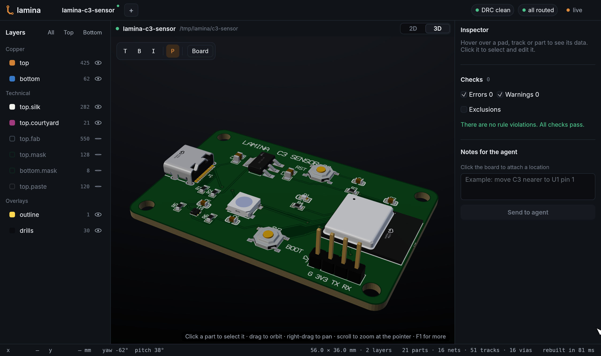

# Example: ESP32-C3 sensor board



This is the board of the GIF in the [README](../../README.md). `build.py` makes it
with the Lamina MCP tools: it starts `lamina mcp` and calls the tools one by one, as an
agent does. Read the script to see each call and its arguments.

```sh
python3 examples/c3-sensor/build.py       # makes ./c3-sensor, in about ten seconds
lamina-viewer c3-sensor
```

Open the viewer on the folder before you run the script to see the board grow:
`lamina-viewer c3-sensor`, then run the script in another terminal.

You need Python 3.8 or later and a network: the parts come from LCSC, with their
footprints, 3D models and pin names. If `lamina` is not on your `PATH`, give it with
`--lamina target/release/lamina`. `--out DIR` puts the board in another folder.

## The board

56 × 36 mm, 2 layers, the JLCPCB 2-layer rules, 21 parts:

| Ref | Part | LCSC |
|---|---|---|
| U1 | ESP32-C3-MINI-1-N4 Wi-Fi and Bluetooth module | C2838502 |
| U2 | AMS1117-3.3 regulator | C6186 |
| U3 | SHT40 temperature and humidity sensor (I2C) | C2848306 |
| D2 | WS2812B RGB LED | C114586 |
| D1 | Red LED, 0603 | C2286 |
| J1 | USB-C receptacle (power and native USB) | C165948 |
| J2 | 4-pin header: GND, 3V3, TX, RX | KiCad library |
| SW1, SW2 | Reset and boot buttons | C318884 |
| R1–R6, C1–C6 | Pull-ups, CC resistors, decoupling | basic parts |

## The steps

1. `open`, `use_fab_preset`: a new project with the JLCPCB 2-layer rules.
2. `import_parts`: the 21 parts, with footprints, 3D models and pin names.
3. `set_outline`, `add_hole`: the board and four M3 holes.
4. `set_nets`, then `check` with the `pin_role` rule: no ground pin is on a power net.
5. `place_many`, five times: USB-C, regulator, module, buttons, sensor.
6. `add_text`: the silkscreen labels.
7. `add_zone` and `autoroute`: ground on both layers, then all 38 connections.
8. `exclude_violation`: the USB-C connector and the antenna are at the board edge by
   design. Each exclusion keeps its reason.
9. `board_stats`.

Then try the viewer: push `2` for 3D, `Ctrl+F` to find a part, `F1` for all the keys.
Or open the board with your agent and ask it for a change.

The script does not call `export`. At the moment, `export` refuses this board: the
USB-C pad names (for example `A1B12`) do not fit the 4-character pin field of the
IPC-D-356 netlist. `export_board` with `format: kicad` and `export_step` work.

## The screenshots

[`scripts/readme-media.py`](../../scripts/readme-media.py) runs this script, takes the
README screenshots with `lamina-viewer shot` and makes the GIF.
