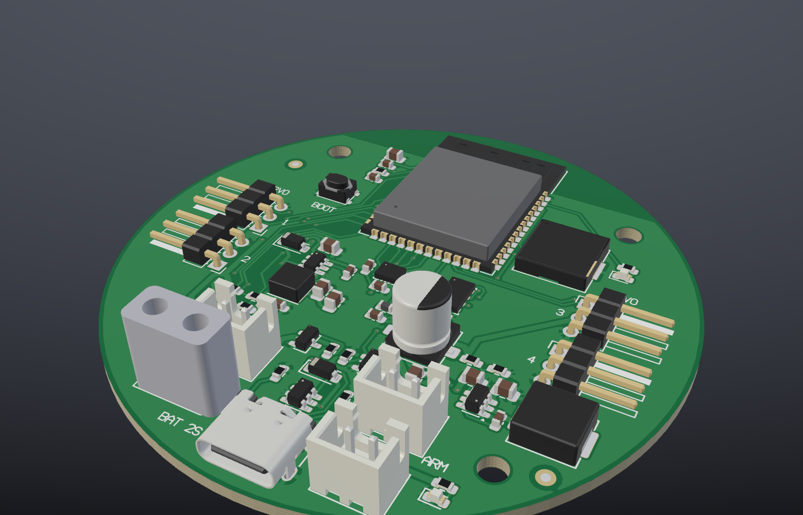
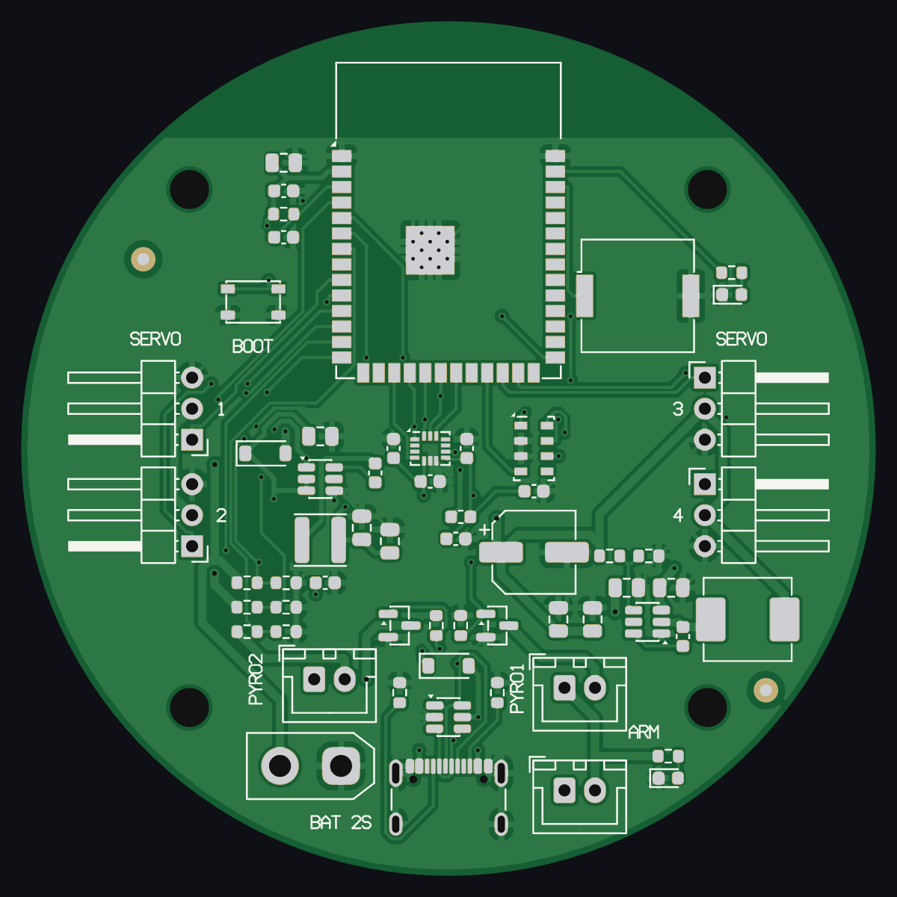
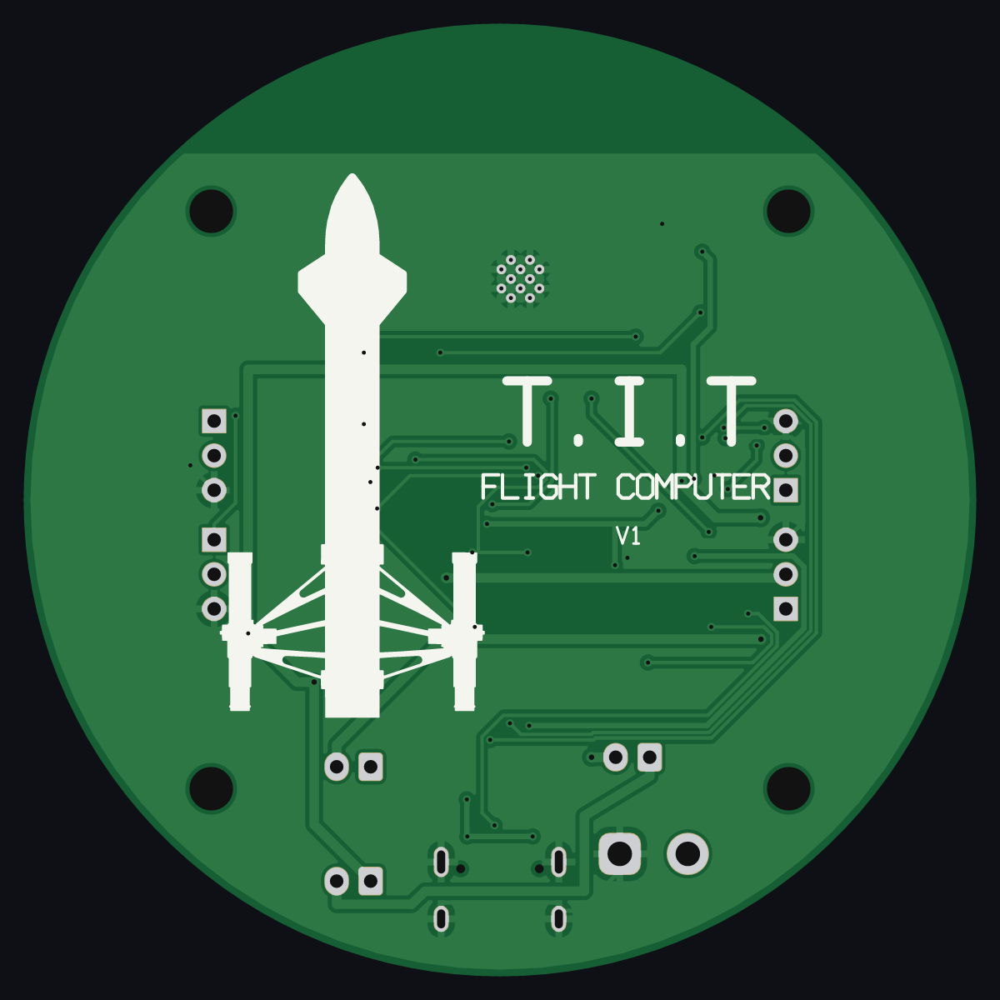

# Example: T.I.T flight computer



A flight computer for a model rocket with four servo fins. The board is round, 70 mm in
diameter, with 2 copper layers and 66 parts, all on the top side.

This folder is a complete Lamina project. Open it with the viewer or with your agent:

```sh
cd examples
lamina-viewer tit-flight-computer
```

| Top | Bottom |
|---|---|
|  |  |

## The board

| Ref | Part | Function |
|---|---|---|
| U1 | ESP32-S3-WROOM-1-N8 | Wi-Fi and Bluetooth module, with USB |
| U5 | ICM-42688-P | 6-axis motion sensor, SPI |
| U6 | MS5611-01BA03 | Pressure sensor, SPI |
| U4 | TPS54302 | 5 V, 3 A supply for the servos |
| U3 | AP63203WU | 3.3 V, 2 A supply for the module and the sensors |
| U2 | USBLC6-2SC6 | USB protection |
| J1 | GCT USB4105-GF-A | USB-C, for programs and logs |
| J2 | AMASS XT30UPB-M | 2-cell battery |
| J3 to J6 | 3-pin headers, 2.54 mm | Servo 1 to servo 4 |
| J7 | JST XH, 2 pins | Arm switch |
| J8, J9 | JST XH, 2 pins | Igniter 1 and igniter 2 (AO3400A switch on the low side) |
| BZ1 | Murata PKMCS0909E4000 | Buzzer |

The two supplies are independent. If the servos pull the 5 V supply down, the module
does not reset. The igniter outputs have voltage only when the arm switch is closed.

## Where the board comes from

The board was made in KiCad from a script, without a schematic. The `import_board` tool
read the `.kicad_pcb` file: outline, parts, footprints, nets, tracks, vias, zones and
texts. Then the `check` tool and a KiCad design rule check examined the result.

## What changed after the import

1. **Antenna keep-out.** The KiCad footprint of the module has a keep-out below the
   antenna. The import did not read it, and the ground pour filled that area on both
   layers. An `add_keepout` area on the two layers puts it back.
2. **Silkscreen on pads.** The bottom drawing and the "Flight Computer" text were
   0.04 to 0.08 mm from the servo pads. They moved by 0.15 to 0.25 mm. The outline of
   U6 no longer touches its pads.
3. **Fiducials.** The ground pour was in the mask opening of the two fiducials. A
   keep-out for pours around each fiducial removes it.
4. **Module ground pad.** A solid ground zone covers the 3.9 mm ground pad of the
   module, so the pad does not hang on thin thermal spokes.
5. **Rules.** `min_annular_ring` is 0.15 mm and `min_silk_text_height` is 1.0 mm.
   These values are in the limits of JLCPCB and PCBWay.
6. **Part numbers.** The manufacturer part numbers come from the first BOM.

## The checks

- Lamina: 0 errors and 0 warnings. Three accepted items have their reasons in
  `board.json`: the corners of two courtyards are outside the round edge, and the via
  pads in the module ground pad do not need thermal spokes.
- KiCad 10, on the board that `export_board` wrote: 0 errors and 0 open connections.
  KiCad gives warnings only for the reference texts. The export writes them at 0.5 mm,
  but the Gerber files of Lamina do not have these texts.

The footprints are from the KiCad library. This example did not compare each footprint
with its datasheet again. The motion sensor uses the Bosch LGA-14 footprint, which has
the same 2.5 × 3 mm pad pattern.

## Files

- `board.json`, `parts.json`, `nets.json`, `placement.json`, `routing.json`: the board.
- `cache/footprints`, `cache/models`: the footprints and the 3D models.
- `output`: Gerber, drill, BOM, CPL and IPC-D-356 files from the `export` tool.

The 3D models are from the KiCad library (CC BY-SA 4.0, with the KiCad library
exception). The battery connector model is a simple block.
