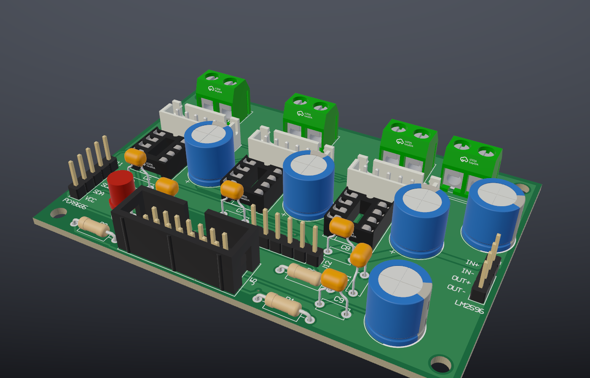
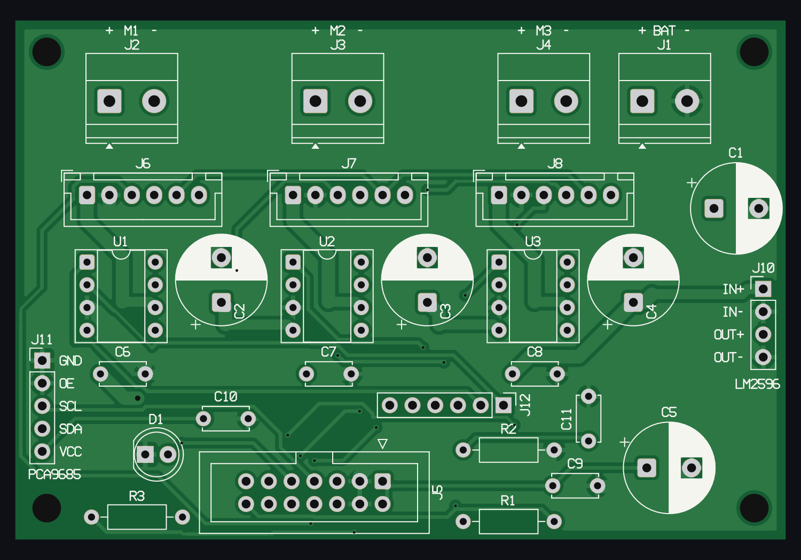
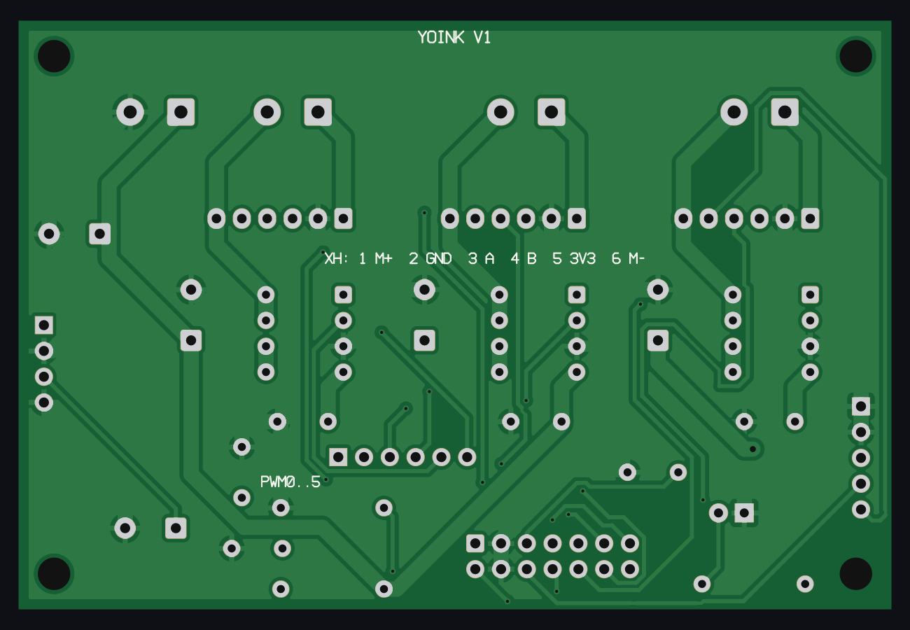

# Example: Yoink main board



The motor board of Yoink, a small robot with three omni wheels. The board is
86 × 58 mm, with 2 copper layers and 33 through-hole parts. You can solder it by hand.

This folder is a complete Lamina project. Open it with the viewer or with your agent:

```sh
cd examples
lamina-viewer yoink-main-board
```

| Top | Bottom |
|---|---|
|  |  |

## The board

| Ref | Part | Function |
|---|---|---|
| U1 to U3 | TA6586 in a DIP-8 socket | One motor driver for each wheel |
| J1 | Terminal block, 5 mm | Battery, 10.5 V to 12.6 V |
| J2 to J4 | Terminal block, 5 mm | Motor power, + and - |
| J6 to J8 | JST XH, 6 pins | Motor cable: power and encoder |
| J5 | IDC header, 2 × 7 | Flat cable to the XIAO ESP32-S3 |
| J11, J12 | Pin headers | PCA9685 PWM module: control pins and PWM 0 to 5 |
| J10 | Pin header | LM2596 5 V supply module |
| C1 to C5 | 100 µF | Supply capacitors |
| R1, R2 | 100 kΩ, 33 kΩ | Battery voltage divider for the ADC |

The power tracks (battery, ground and motors) are 1.5 mm wide. The signal tracks are
0.3 mm to 0.4 mm wide. A ground pour is on each layer.

## Where the board comes from

The board was made in KiCad from a script, and Freerouting made the tracks. The
`import_board` tool read the `.kicad_pcb` file. Then the `check` tool and a KiCad design
rule check examined the result.

## What changed after the import

1. **J11 labels.** One text gave the pin names of the PCA9685 header, but in the
   reverse order of the pins, and not in line with them. Now each pin has its label:
   GND, OE, SCL, SDA and VCC.
2. **Terminal blocks.** The `+` and `-` marks are now above their screws. The name is
   between them.
3. **J10 labels.** Each pin of the LM2596 header has its label: IN+, IN-, OUT+, OUT-.
4. **Text size.** All the silkscreen texts are 1.0 mm high. They were 0.8 mm.
5. **Mounting holes.** The H1 to H4 texts are gone. Two of them were outside the board
   edge.
6. **PWM label.** The bottom text was 0.07 mm from a capacitor pad. It moved.
7. **Rules.** `min_annular_ring` is 0.15 mm and `min_silk_text_height` is 1.0 mm.
   These values are in the limits of JLCPCB and PCBWay.

## The checks

- Lamina: 0 errors and 0 warnings. Five accepted items have their reasons in
  `board.json`: through-hole ground pads with one thermal spoke on the top layer. The
  bottom layer connects each of them with the full number of spokes.
- KiCad 10, on the board that `export_board` wrote: 0 open connections and 0 clearance
  errors. KiCad reports one thermal item at C7: its bottom spokes go to a small piece
  of pour that touches nothing else. The 1.5 mm ground track on the top layer connects
  that pad, so the circuit is correct.

**Before you order this board:** the pin order of the motor connectors J6 to J8 is not
confirmed with the real motors.

## Files

- `board.json`, `parts.json`, `nets.json`, `placement.json`, `routing.json`: the board.
- `cache/footprints`, `cache/models`: the footprints and the 3D models.
- `output`: Gerber, drill, BOM, CPL and IPC-D-356 files from the `export` tool.

The 3D models are from the KiCad library (CC BY-SA 4.0, with the KiCad library
exception). The models of the terminal blocks, the DIP sockets and the ceramic
capacitors are not in this folder, because their licence does not let us copy them.
The viewer shows these parts without a body. The picture above has them.
